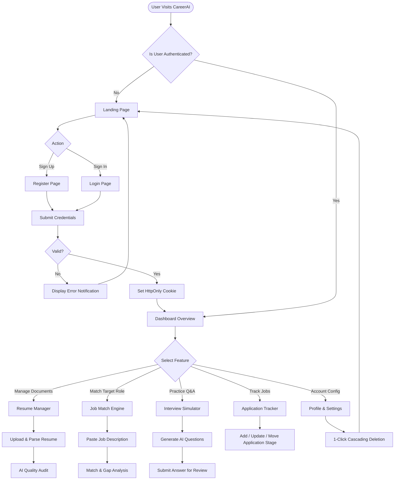
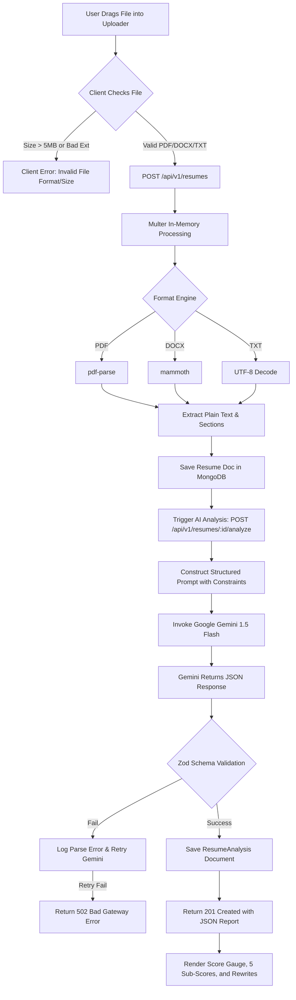
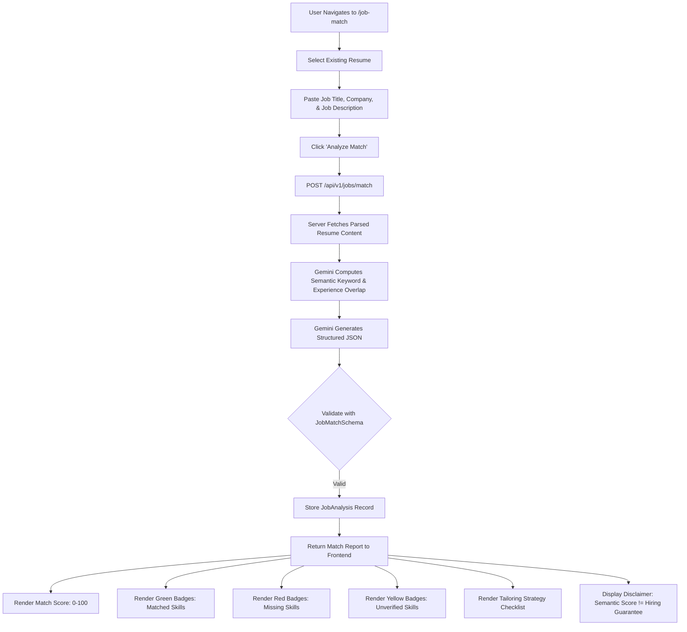
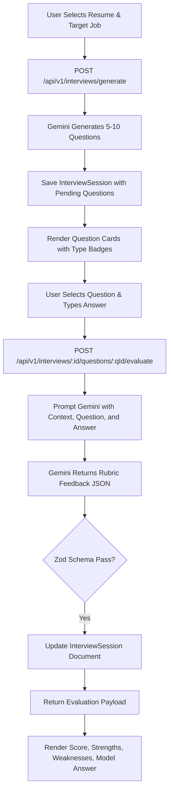

# CareerAI — Application Flow & UX Architecture

**Document Version:** 1.0.0  
**Status:** Approved UX Flow Specification  
**Product Name:** CareerAI — AI Resume Analyzer & Job Match Platform  
**Author:** UI/UX Planner & Frontend Lead  
**Last Updated:** 2026-10-10  

---

## 1. Route Map & Protection Matrix

| Route Path | View / Component | Access Level | Description |
|---|---|---|---|
| `/` | `LandingPage` | Public | Hero section, feature showcases, value proposition, CTA. |
| `/login` | `LoginPage` | Public (Guest Only) | Email & password credentials form, redirects to `/dashboard` if authenticated. |
| `/register` | `RegisterPage` | Public (Guest Only) | Registration form with instant password criteria validation. |
| `/dashboard` | `DashboardPage` | **Protected** | High-level metrics, quick actions, score trends, and recent analyses. |
| `/resumes` | `ResumesPage` | **Protected** | Resume document list, upload dropzone, and status overview. |
| `/resumes/:id` | `ResumeDetailPage` | **Protected** | Extracted text view, quality score gauge, bullet suggestions, and category breakdowns. |
| `/job-match` | `JobMatchPage` | **Protected** | Side-by-side job matching tool, skill gap badges, and role-tailoring advice. |
| `/interviews` | `InterviewPrepPage` | **Protected** | Interview question generator, interactive answer submission, and AI score feedback. |
| `/tracker` | `ApplicationTrackerPage` | **Protected** | Kanban / Table view of job applications across hiring stages. |
| `/profile` | `ProfilePage` | **Protected** | Personal details, career preferences, target roles. |
| `/settings` | `SettingsPage` | **Protected** | Security settings, session overview, and 1-Click Total Account Deletion. |
| `*` | `NotFoundPage` | Public | Friendly 404 screen with navigation back to Dashboard or Home. |

---

## 2. Mermaid Workflow Diagrams

### 2.1 Main Application Flow



---

### 2.2 Authentication & Session Flow

```mermaid
sequenceDiagram
    autonumber
    actor User
    participant ReactClient as React (Vite Client)
    participant ExpressAPI as Express.js API
    participant MongoDB as MongoDB Database

    Note over User,MongoDB: User Login Flow
    User->>ReactClient: Enters Email & Password
    ReactClient->>ExpressAPI: POST /api/v1/auth/login
    ExpressAPI->>MongoDB: User.findOne({ email })
    MongoDB-->>ExpressAPI: Returns User Document (with bcrypt hash)
    ExpressAPI->>ExpressAPI: bcrypt.compare(password, hash)
    alt Invalid Credentials
        ExpressAPI-->>ReactClient: 401 Unauthorized { code: "INVALID_CREDENTIALS" }
        ReactClient-->>User: Show Toast: "Invalid email or password"
    else Valid Credentials
        ExpressAPI->>ExpressAPI: Generate JWT (userId, email)
        ExpressAPI-->>ReactClient: 200 OK (Set-Cookie: token=JWT; HttpOnly; SameSite=Strict) + User Profile
        ReactClient->>ReactClient: Set AuthContext state { user, isAuthenticated: true }
        ReactClient-->>User: Redirect to /dashboard
    end

    Note over User,MongoDB: Session Bootstrap Flow (On Page Refresh)
    User->>ReactClient: Reloads Browser Page
    ReactClient->>ExpressAPI: GET /api/v1/auth/me (Cookie automatically sent)
    alt Valid Cookie
        ExpressAPI->>MongoDB: User.findById(decoded.userId)
        MongoDB-->>ExpressAPI: User Data
        ExpressAPI-->>ReactClient: 200 OK { user }
        ReactClient->>ReactClient: Restore AuthContext
    else Invalid / Expired Cookie
        ExpressAPI-->>ReactClient: 401 Unauthorized
        ReactClient->>ReactClient: Reset AuthContext { user: null, isAuthenticated: false }
        ReactClient-->>User: Redirect to /login
    end
```

---

### 2.3 Resume Analysis Flow



---

### 2.4 Job Matching & Skill Gap Flow



---

### 2.5 AI Interview Preparation & Evaluation Flow



---

## 3. UI State Handling Specifications

### 3.1 Loading States
- **Page Transitions:** Top progress bar (NProgress style) or central pulsing brand indicator.
- **Data Tables & Cards:** Shimmer skeleton placeholders matching target layout dimensions.
- **AI Processing Triggers:** Interactive progress animation with step updates (e.g., *"Extracting text..."* $\to$ *"Consulting AI evaluator..."* $\to$ *"Formatting recommendations..."*).

### 3.2 Empty States
- **No Resumes:** Friendly illustration, clear prompt *"Upload your first resume in PDF, DOCX, or TXT format to begin."*, primary CTA button *"Upload Resume"*.
- **No Job Matches:** Visual helper guide explaining the benefit of matching resumes with job postings, CTA *"New Job Match"*.
- **No Applications in Tracker:** Clean Kanban board with placeholder cards showing drag-and-drop mechanics and CTA *"Add Application"*.

### 3.3 Error States & Boundary Protection
- **Global Error Boundary:** Catches unhandled React component exceptions, displays friendly recovery screen with *"Reload Page"* or *"Return to Dashboard"* buttons.
- **Network Failure / 500s:** Non-intrusive floating toast notifications detailing the problem without leaking raw technical traces to end users.
- **Session Expiry (401):** Smooth redirect to `/login` with toast notification *"Session expired. Please sign in again."*
