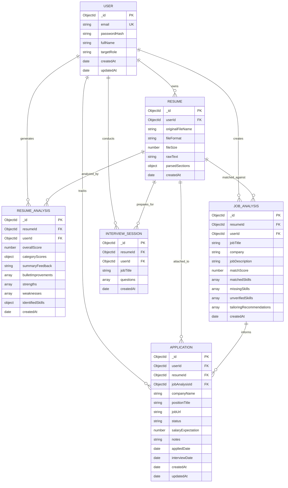

# CareerAI — Database Schema & Data Architecture

**Document Version:** 1.0.0  
**Status:** Approved Data Model Specification  
**Database Engine:** MongoDB Atlas (v7.0+)  
**Object Data Modeling (ODM):** Mongoose (v8+)  
**Author:** Principal Database Architect & Backend Lead  
**Last Updated:** 2026-10-10  

---

## 1. Entity-Relationship (ER) Architecture



---

## 2. Detailed Collection Specifications

### 2.1 Collection: `users`
- **Purpose:** Manages registered user credentials, profile information, and system preferences.
- **Ownership:** Root tenant entity.
- **Security Rule:** The `passwordHash` field MUST be excluded from all default queries (`select: false`).

| Field Name | Type | Required | Default | Validation & Constraints | Description |
|---|---|---|---|---|---|
| `_id` | `ObjectId` | Yes | Auto | MongoDB Primary Key | Unique user identifier |
| `email` | `String` | Yes | N/A | Lowercase, trimmed, valid email regex, unique index | User login and contact email |
| `passwordHash` | `String` | Yes | N/A | Min length 60 (bcrypt hash), `select: false` | Hashed password |
| `fullName` | `String` | Yes | N/A | Trimmed, length between 2 and 100 characters | User's full name |
| `targetRole` | `String` | No | `""` | Max length 120 characters | Target job position preference |
| `careerLevel` | `String` | No | `"Entry"` | Enum: `["Entry", "Mid", "Senior", "Lead", "Executive"]` | Experience tier |
| `createdAt` | `Date` | Yes | `Date.now` | Immutable timestamp | Account creation date |
| `updatedAt` | `Date` | Yes | `Date.now` | Auto-updated timestamp | Last profile update |

- **Indexes:**
  - `{ email: 1 }` (Unique, Collation: `{ locale: 'en', strength: 2 }` for case-insensitivity)

---

### 2.2 Collection: `resumes`
- **Purpose:** Stores raw text extracted from uploaded documents along with structured section metadata.
- **Ownership:** Belongs to `users` (`userId`).

| Field Name | Type | Required | Default | Validation & Constraints | Description |
|---|---|---|---|---|---|
| `_id` | `ObjectId` | Yes | Auto | MongoDB Primary Key | Resume record ID |
| `userId` | `ObjectId` | Yes | N/A | Ref: `User`, Indexed | Owner reference |
| `originalFileName`| `String` | Yes | N/A | Max length 255 | Original client file name |
| `fileFormat` | `String` | Yes | N/A | Enum: `["pdf", "docx", "txt"]` | Uploaded document type |
| `fileSize` | `Number` | Yes | N/A | Max $5,242,880$ bytes (5 MB) | File size in bytes |
| `rawText` | `String` | Yes | N/A | Min length 20, max length 500,000 chars | Clean extracted plain text |
| `parsedSections` | `Object` | No | `{}` | Key-value pairs of detected sections | Extracted sections (experience, education, etc.) |
| `createdAt` | `Date` | Yes | `Date.now` | Auto | Upload timestamp |

- **Indexes:**
  - `{ userId: 1, createdAt: -1 }` (Compound index for fast user-scoped chronological listing)

---

### 2.3 Collection: `resumeanalyses`
- **Purpose:** Stores structured AI evaluation reports, sub-scores, and line-by-line rewrite suggestions for a specific resume.
- **Ownership:** Belongs to `users` (`userId`) and references `resumes` (`resumeId`).

| Field Name | Type | Required | Default | Validation & Constraints | Description |
|---|---|---|---|---|---|
| `_id` | `ObjectId` | Yes | Auto | Primary Key | Analysis record ID |
| `userId` | `ObjectId` | Yes | N/A | Ref: `User`, Indexed | Owner reference |
| `resumeId` | `ObjectId` | Yes | N/A | Ref: `Resume`, Indexed | Analyzed resume reference |
| `overallScore` | `Number` | Yes | N/A | Min 0, Max 100 | Composite quality score |
| `categoryScores` | `Object` | Yes | N/A | Object with 5 numeric keys (0–100) | Breakdown scores (impact, brevity, style, skills, ATS) |
| `summaryFeedback`| `String` | Yes | N/A | Min length 10 | Executive evaluation summary |
| `bulletImprovements`| `Array` | Yes | `[]` | Array of objects `{ original, issue, rewrite, impact }` | Line-by-line actionable feedback |
| `strengths` | `[String]` | Yes | `[]` | Array of strings | Key identified positive elements |
| `weaknesses` | `[String]` | Yes | `[]` | Array of strings | Key identified areas of improvement |
| `identifiedSkills`| `Object` | Yes | `{}` | Sub-arrays: `technical`, `soft`, `tools` | Extracted competencies |
| `createdAt` | `Date` | Yes | `Date.now` | Auto | Analysis creation timestamp |

- **Indexes:**
  - `{ userId: 1, createdAt: -1 }`
  - `{ resumeId: 1, createdAt: -1 }`

---

### 2.4 Collection: `jobanalyses`
- **Purpose:** Stores job description matching metrics, skill overlap analyses, and role-tailoring advice.
- **Ownership:** Belongs to `users` (`userId`) and references `resumes` (`resumeId`).

| Field Name | Type | Required | Default | Validation & Constraints | Description |
|---|---|---|---|---|---|
| `_id` | `ObjectId` | Yes | Auto | Primary Key | Job match record ID |
| `userId` | `ObjectId` | Yes | N/A | Ref: `User`, Indexed | Owner reference |
| `resumeId` | `ObjectId` | Yes | N/A | Ref: `Resume`, Indexed | Target resume reference |
| `jobTitle` | `String` | Yes | N/A | Trimmed, max length 150 | Target job position title |
| `company` | `String` | No | `""` | Trimmed, max length 150 | Target employer name |
| `jobDescription` | `String` | Yes | N/A | Min length 50, max length 50,000 chars | Raw job description text |
| `matchScore` | `Number` | Yes | N/A | Min 0, Max 100 | Semantic alignment score (assistive only) |
| `matchedSkills` | `[String]` | Yes | `[]` | Array of strings | Skills verified in both resume & job |
| `missingSkills` | `[String]` | Yes | `[]` | Array of strings | Skills requested in job but absent in resume |
| `unverifiedSkills`| `[String]`| Yes | `[]` | Array of strings | Skills implied or weakly evidenced |
| `tailoringRecommendations`| `[String]`| Yes | `[]` | Array of strings | Actionable steps to tailor resume |
| `createdAt` | `Date` | Yes | `Date.now` | Auto | Match record timestamp |

- **Indexes:**
  - `{ userId: 1, createdAt: -1 }`
  - `{ resumeId: 1 }`

---

### 2.5 Collection: `interviewsessions`
- **Purpose:** Tracks AI-generated interview question sets and user-submitted answers with AI evaluation rubrics.
- **Ownership:** Belongs to `users` (`userId`) and references `resumes` (`resumeId`).

| Field Name | Type | Required | Default | Validation & Constraints | Description |
|---|---|---|---|---|---|
| `_id` | `ObjectId` | Yes | Auto | Primary Key | Session identifier |
| `userId` | `ObjectId` | Yes | N/A | Ref: `User`, Indexed | Owner reference |
| `resumeId` | `ObjectId` | Yes | N/A | Ref: `Resume` | Source resume reference |
| `jobTitle` | `String` | Yes | N/A | Max length 150 | Role context for questions |
| `questions` | `Array` | Yes | `[]` | Array of Question Subdocuments | List of generated questions & answers |
| `createdAt` | `Date` | Yes | `Date.now` | Auto | Session timestamp |

#### Question Subdocument Structure:
```javascript
{
  _id: ObjectId,
  questionText: String,      // Generated question text
  category: String,          // Enum: ["Technical", "Behavioral", "Situational"]
  difficulty: String,        // Enum: ["Junior", "Mid", "Senior"]
  sampleKeyPoints: [String], // Points that should be addressed
  userAnswer: String,        // Optional: user's submitted response
  evaluation: {
    score: Number,           // 0-100 score
    strengths: [String],
    weaknesses: [String],
    missingPoints: [String],
    modelAnswer: String,
    evaluatedAt: Date
  }
}
```

- **Indexes:**
  - `{ userId: 1, createdAt: -1 }`

---

### 2.6 Collection: `applications`
- **Purpose:** Centralized pipeline tracking user job applications across hiring lifecycle stages.
- **Ownership:** Belongs to `users` (`userId`).

| Field Name | Type | Required | Default | Validation & Constraints | Description |
|---|---|---|---|---|---|
| `_id` | `ObjectId` | Yes | Auto | Primary Key | Application identifier |
| `userId` | `ObjectId` | Yes | N/A | Ref: `User`, Indexed | Owner reference |
| `resumeId` | `ObjectId` | No | `null` | Ref: `Resume` | Attached resume version |
| `jobAnalysisId` | `ObjectId` | No | `null` | Ref: `JobAnalysis` | Linked job match record |
| `companyName` | `String` | Yes | N/A | Trimmed, max length 150 | Employer name |
| `positionTitle` | `String` | Yes | N/A | Trimmed, max length 150 | Job role |
| `jobUrl` | `String` | No | `""` | Valid URL regex or empty | Link to job posting |
| `status` | `String` | Yes | `"Saved"` | Enum: `["Saved", "Applied", "Interviewing", "Offered", "Rejected", "Withdrawn"]` | Current stage |
| `salaryExpectation`| `Number` | No | `null` | Min 0 | Expected or offered compensation |
| `notes` | `String` | No | `""` | Max length 2,000 | Personal notes and recruiter contacts |
| `appliedDate` | `Date` | No | `null` | Timestamp | Date application was submitted |
| `interviewDate` | `Date` | No | `null` | Timestamp | Scheduled interview datetime |
| `createdAt` | `Date` | Yes | `Date.now` | Auto | Record creation timestamp |
| `updatedAt` | `Date` | Yes | `Date.now` | Auto | Last status change timestamp |

- **Indexes:**
  - `{ userId: 1, status: 1 }` (Optimized for Kanban board column rendering)
  - `{ userId: 1, updatedAt: -1 }`

---

## 3. Data Retention, Privacy & Cascading Deletion Strategy

### 3.1 Total Account Purge (1-Click Privacy Deletion)
When a user deletes their account (`DELETE /api/v1/users/me`), the controller executes a clean, sequential purge across all collections:

```javascript
// Pseudocode for cascading account deletion
async function deleteUserAccountAndData(userId) {
  await ResumeAnalysis.deleteMany({ userId });
  await JobAnalysis.deleteMany({ userId });
  await InterviewSession.deleteMany({ userId });
  await Application.deleteMany({ userId });
  await Resume.deleteMany({ userId });
  await User.findByIdAndDelete(userId);
}
```

### 3.2 Pagination Strategy
All list endpoints (`GET /api/v1/resumes`, `GET /api/v1/applications`, etc.) implement standardized cursor-less or offset-based pagination:
- Query parameters: `page` (default `1`), `limit` (default `20`, max `50`).
- Metadata returned: `totalCount`, `totalPages`, `currentPage`, `hasNextPage`.
