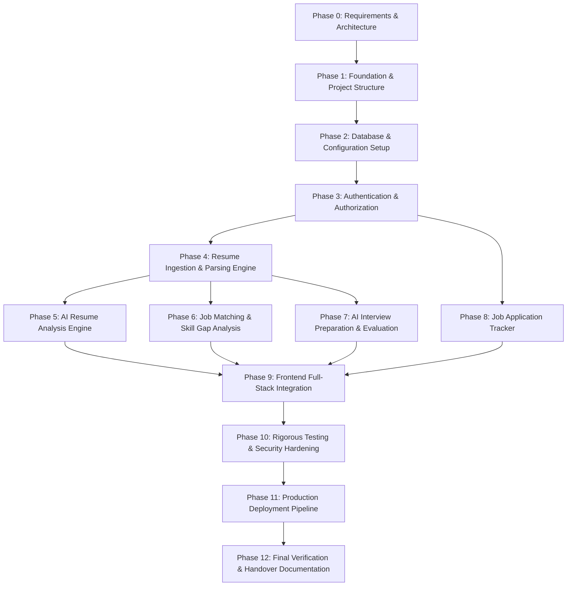

# CareerAI — Engineering Implementation Roadmap

**Document Version:** 1.0.0  
**Status:** Approved Master Roadmap  
**Product Name:** CareerAI — AI Resume Analyzer & Job Match Platform  
**Author:** Full-Stack Engineering Lead & Technical Architect  
**Last Updated:** 2026-10-10  

---

## 1. Phase Dependency Graph

---

## 2. Detailed Phase Specifications

---

### Phase 0: Requirements and Architecture Documentation
- **Status:** **COMPLETE** (Current Phase)
- **Objectives:** Establish comprehensive product specifications, technical architecture, schema definitions, API contracts, and user flows.
- **Tasks:**
  - Author `docs/PRD.md`, `docs/TRD.md`, `docs/SRS.md`, `docs/APP_FLOW.md`, `docs/DATABASE_SCHEMA.md`, `docs/API_DOCUMENTATION.md`, `docs/IMPLEMENTATION_ROADMAP.md`, and root `README.md`.
  - Validate Mermaid diagrams and cross-document consistency.
- **Dependencies:** None.
- **Deliverables:** Approved documentation suite in `/docs` and root `README.md`.
- **Acceptance Criteria:**
  - [x] All 8 Markdown documents exist and are structurally complete.
  - [x] Clear disclaimer that semantic match score does not equal guaranteed hiring probability.
  - [x] Unique IDs assigned to functional and non-functional requirements.
- **Completion Checklist:**
  - [x] PRD created
  - [x] TRD created
  - [x] SRS created
  - [x] APP_FLOW created
  - [x] DATABASE_SCHEMA created
  - [x] API_DOCUMENTATION created
  - [x] IMPLEMENTATION_ROADMAP created
  - [x] README created

---

### Phase 1: Repository and Application Foundation
- **Status:** Pending Execution
- **Objectives:** Initialize monorepo / multi-tier workspace layout for `server` and `client` without placeholder clutter.
- **Tasks:**
  - Initialize Node.js backend workspace in `/server` with `package.json`, `.gitignore`, `.env.example`.
  - Initialize React + Vite frontend workspace in `/client` with Tailwind CSS and Lucide icons.
  - Configure root npm workspace scripts for unified development (`npm run dev`).
- **Dependencies:** Phase 0.
- **Deliverables:** Bootstrapped, runnable backend server and frontend development environments.
- **Tests:**
  - `GET /health` returns HTTP 200 `{ status: "ok" }`.
  - Client dev server renders Vite initial landing shell cleanly.
- **Acceptance Criteria:**
  - Both client and server start with clean logs and zero unhandled errors.

---

### Phase 2: Database and Configuration Setup
- **Status:** Pending Execution
- **Objectives:** Connect backend to MongoDB Atlas and configure environment schema validation.
- **Tasks:**
  - Create Zod environment validator (`server/src/config/env.js`) for all required keys (`PORT`, `MONGO_URI`, `JWT_SECRET`, `GEMINI_API_KEY`, `CLIENT_URL`).
  - Create robust Mongoose connection module (`server/src/config/db.js`) with reconnect handlers and pool controls.
  - Implement Mongoose models: `User`, `Resume`, `ResumeAnalysis`, `JobAnalysis`, `InterviewSession`, `Application`.
- **Dependencies:** Phase 1.
- **Deliverables:** Validated DB connection and all 6 Mongoose schema models.
- **Tests:**
  - Database connection test script connecting and disconnecting cleanly.
  - Index verification script confirming uniqueness on `users.email`.
- **Acceptance Criteria:**
  - Server halts with descriptive error if required environment variables are absent.
  - Database establishes pooled connection with retry handling.

---

### Phase 3: Authentication and Authorization
- **Status:** Pending Execution
- **Objectives:** Implement secure, cookie-based JWT authentication and user ownership middleware.
- **Tasks:**
  - Build `authController` (Register, Login, Logout, Me, Refresh).
  - Implement password hashing with bcrypt (10 rounds).
  - Implement `authMiddleware` reading HttpOnly JWT cookies and attaching `req.user`.
  - Implement 1-Click Total Data Deletion endpoint (`DELETE /api/v1/users/me`) with cascading wipes.
- **Dependencies:** Phase 2.
- **Deliverables:** Complete auth pipeline with cookie security.
- **Tests:**
  - Unit & integration tests for registration, valid login, invalid password rejection, duplicate email conflict, session restore via `/api/v1/auth/me`, and cascading account deletion.
  - Security test verifying `HttpOnly; SameSite=Strict` cookie flags.
- **Acceptance Criteria:**
  - Passwords never stored in plain text.
  - Protected routes reject unauthenticated requests with HTTP 401.

---

### Phase 4: Resume Ingestion and Parsing Engine
- **Status:** Pending Execution
- **Objectives:** Ingest PDF, DOCX, and TXT files, extract plain text, and identify structured sections.
- **Tasks:**
  - Configure Multer memory storage with 5 MB threshold and MIME validation.
  - Implement `parserService.js` supporting `pdf-parse`, `mammoth`, and UTF-8 text.
  - Build section detection parser (Summary, Experience, Education, Skills, Projects).
  - Build CRUD endpoints (`POST /api/v1/resumes`, `GET /api/v1/resumes`, `GET /api/v1/resumes/:id`, `DELETE /api/v1/resumes/:id`).
- **Dependencies:** Phase 3.
- **Deliverables:** Robust multi-format document extraction service and resume endpoints.
- **Tests:**
  - Test PDF parsing with sample multi-page document.
  - Test DOCX parsing with sample Word document.
  - Test corrupted/binary file rejection (HTTP 422).
  - Test file size $> 5\text{MB}$ rejection (HTTP 400).
  - IDOR test: User B cannot fetch or delete User A's resume.
- **Acceptance Criteria:**
  - Document text extracted cleanly without server crash.

---

### Phase 5: AI Resume Analysis Engine
- **Status:** Complete
- **Objectives:** Integrate Google Gemini API for deep resume quality scoring and actionable bullet suggestions.
- **Tasks:**
  - Implement `geminiService.js` using `@google/genai` SDK with JSON Schema structured output and timeout handlers.
  - Define `geminiAnalysisResponseSchema` in Zod and implement deterministic server-calculated weighted scoring formula.
  - Implement `POST /api/v1/resumes/:id/analyze`, `GET /api/v1/resumes/:id/analyses`, `GET /api/v1/analyses/:id`, and `GET /api/v1/analyses`.
  - Persist rich evaluations in `ResumeAnalysis` collection with user-scoped isolation.
- **Dependencies:** Phase 4.
- **Deliverables:** Working AI resume evaluation pipeline.
- **Tests:**
  - Mocked Gemini integration test validating Zod schema parsing.
  - Error handling test for AI rate limits (HTTP 429/503).
- **Acceptance Criteria:**
  - AI analysis returns validated JSON with score and bullet rewrites in $< 15\text{ seconds}$.

---

### Phase 6: Job Matching and Skill Gap Analysis
- **Status:** Complete
- **Objectives:** Compare parsed resumes against target job descriptions with deterministic scoring and actionable skill gap recommendations.
- **Tasks:**
  - Build `jobMatchService.js` using `@google/genai` with JSON Schema structured output and timeout handlers.
  - Define `geminiJobMatchResponseSchema` and `calculateOverallMatchScore` ($0.40 \times \text{Skills} + 0.30 \times \text{Experience} + 0.15 \times \text{Education} + 0.15 \times \text{Responsibility}$).
  - Implement endpoints: `POST /api/v1/job-matches`, `GET /api/v1/job-matches`, `GET /api/v1/job-matches/:id`, and `DELETE /api/v1/job-matches/:id`.
  - Persist structured reports in `JobAnalysis` collection with user-scoped isolation and mandatory advisory disclaimer.
- **Dependencies:** Phase 4 & Phase 5.
- **Deliverables:** Bi-directional matching API endpoints, schema persistence, and interactive frontend interface (`/job-matches`).
- **Tests:**
  - 16 Vitest integration tests covering mocked matching, deterministic scoring, Zod validation, error status mappings, IDOR security, and deletion.
- **Acceptance Criteria:**
  - Validated payload with matched skills evidence, missing skills, partial matches, experience alignment, and prominent hiring disclaimer.

---

### Phase 7: AI Interview Preparation and Evaluation
- **Status:** Pending Execution
- **Objectives:** Generate tailored interview questions and provide rubric-based answer evaluations.
- **Tasks:**
  - Implement `POST /api/v1/interviews/generate` producing 5–10 Technical, STAR Behavioral, and Situational questions.
  - Implement `POST /api/v1/interviews/:id/questions/:qId/evaluate` scoring user answers (0–100) with strengths, weaknesses, and model answers.
- **Dependencies:** Phase 4.
- **Deliverables:** Interactive interview Q&A evaluation endpoints.
- **Tests:**
  - Test question generation schema.
  - Test answer evaluation response schema.
- **Acceptance Criteria:**
  - Generates tailored questions and evaluates answers with actionable feedback.

---

### Phase 8: Job Application Tracker
- **Status:** Pending Execution
- **Objectives:** CRUD pipeline for tracking job applications across statuses.
- **Tasks:**
  - Build `applicationController` (`POST`, `GET`, `PATCH`, `DELETE /api/v1/applications`).
  - Enable optional linking to `resumeId` and `jobAnalysisId`.
  - Implement `GET /api/v1/dashboard/stats` aggregating user pipeline metrics.
- **Dependencies:** Phase 3.
- **Deliverables:** Application tracker and dashboard stats endpoints.
- **Tests:**
  - Application CRUD integration tests.
  - Ownership test ensuring user data isolation.
- **Acceptance Criteria:**
  - Complete application management with fast indexed status queries.

---

### Phase 9: Frontend Full-Stack Integration
- **Status:** Pending Execution
- **Objectives:** Build responsive, accessible React UI connecting to all backend endpoints.
- **Tasks:**
  - Implement `AuthContext` and route protection guards (`ProtectedRoute.jsx`).
  - Build Dashboard, Resume Uploader & Viewer, Quality Score Gauges, Job Match Tool, Interview Q&A Simulator, and Kanban Application Tracker.
  - Implement loading skeletons, empty states, and toast notifications.
  - Add account deletion UI in Settings with double-confirmation modal.
- **Dependencies:** Phases 3, 5, 6, 7, 8.
- **Deliverables:** Fully functioning, polished web application UI.
- **Tests:**
  - End-to-end user journey tests across all views.
- **Acceptance Criteria:**
  - WCAG AA compliant contrast and smooth responsive mobile/desktop layouts.

---

### Phase 10: Testing and Security Hardening
- **Status:** Pending Execution
- **Objectives:** Execute end-to-end test suite and enforce defense-in-depth security policies.
- **Tasks:**
  - Configure Helmet security headers, CORS origin enforcement, and rate limiters.
  - Run full suite of IDOR security tests (cross-user access attempts).
  - Verify zero secrets in client bundle and environment configs.
- **Dependencies:** Phase 9.
- **Deliverables:** Verified secure and tested platform.
- **Acceptance Criteria:**
  - Zero IDOR vulnerabilities, 100% automated test pass rate.

---

### Phase 11: Production Deployment Pipeline
- **Status:** Pending Execution
- **Objectives:** Prepare production build and deployment configuration.
- **Tasks:**
  - Create production Dockerfile / build scripts for client and server.
  - Configure MongoDB Atlas production cluster and environment secrets.
  - Set up CI/CD GitHub Actions workflow for linting and testing.
- **Dependencies:** Phase 10.
- **Deliverables:** Deployment-ready configurations and documentation.
- **Acceptance Criteria:**
  - Clean production build with optimized asset bundles.

---

### Phase 12: Final Verification and Handover Documentation
- **Status:** Pending Execution
- **Objectives:** Final end-to-end verification, architecture sign-off, and operational documentation.
- **Tasks:**
  - Conduct full user journey validation on production build.
  - Create operations manual and API change log.
- **Dependencies:** Phase 11.
- **Deliverables:** Final project report and handover sign-off.
- **Acceptance Criteria:**
  - Platform fully verified against all functional and non-functional requirements.
